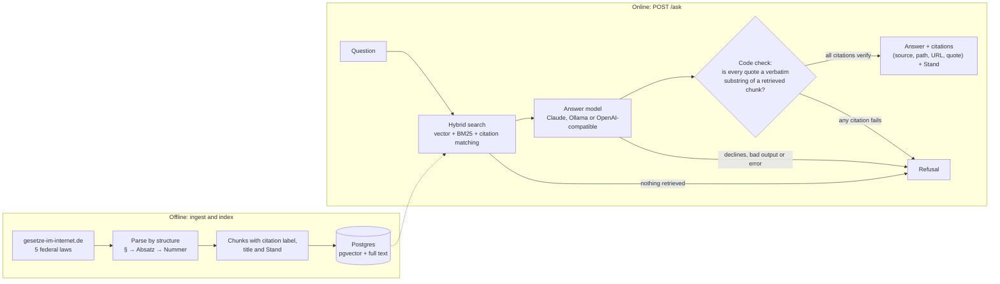
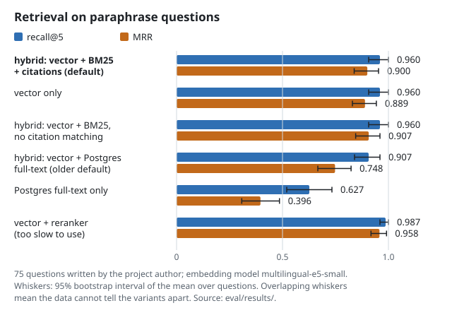
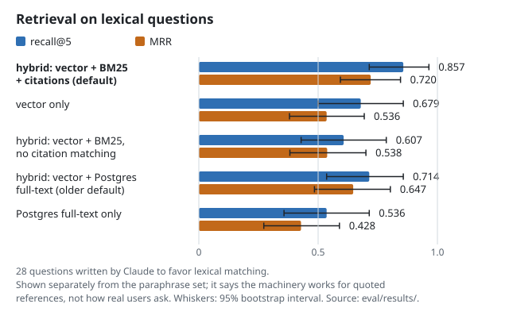
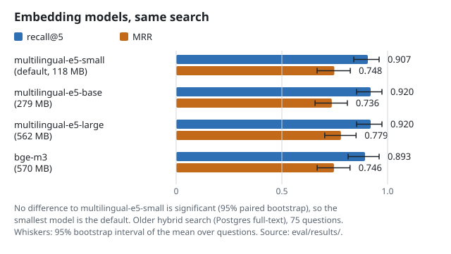
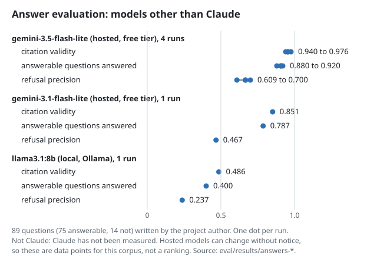

<h1 align="center">Normkompass</h1>

<p align="center"><b>RAG with verifiable citations for German federal law.</b><br>
Every answer points to the exact passage, for example "§ 14 Abs. 1 UStG". If the corpus does not support an
answer, the service refuses instead of guessing.</p>

<p align="center">
  <a href="https://github.com/sotream/normkompass/actions/workflows/ci.yml"></a>
  <a href="LICENSE"></a>
  
  
  
  
</p>

The demo corpus is German federal law from gesetze-im-internet.de. This is a reference implementation, not a
finished product; see "Honest limits".

## Contents

**Overview**

- [Status](#status)
- [How it works](#how-it-works)
- [Results at a glance](#results-at-a-glance)
- [How this was built](#how-this-was-built)
- [Not legal advice](#not-legal-advice)

**Use it**

- [Quick start](#quick-start)
- [Answer providers](#answer-providers)
- [Bring your own corpus](#bring-your-own-corpus)
- [Related projects](#related-projects)

**How it works in detail**

- [Corpus model](#corpus-model)
- [Search](#search)
- [Answers and citations](#answers-and-citations)
- [Process](#process)

**Results and limits**

- [Retrieval results](#retrieval-results)
- [Answer evaluation](#answer-evaluation)
- [Honest limits](#honest-limits)

**Project**

- [License](#license)

## Status

Reference implementation, all planned v1 phases implemented: project scaffold, corpus ingest with a
structure-aware parser for the demo laws, hybrid search with a retrieval evaluation and an embedding
comparison (ADR 0002), and answer generation with code-checked citations and refusal. It is not a finished
product. See "Honest limits" for what is not known or not done, in particular that Claude itself has not
been measured and that the default search is hybrid with BM25 and citation matching, chosen by a rule fixed before the runs (ADR 0004), after an earlier hybrid scored below vector-only (ADR 0003).

## How it works



The model proposes an answer with quotes; the code, not the model, decides whether it is shown. One failed
citation turns the whole answer into a refusal. A worked example with a real answer and a real refusal is in
[docs/worked-example.md](docs/worked-example.md).

## Results at a glance

| What was measured                                                          | Result                                                                                 |
| -------------------------------------------------------------------------- | -------------------------------------------------------------------------------------- |
| Default search on 75 paraphrase questions                                  | recall@5 0.960, MRR 0.900, not significantly different from vector-only (0.960, 0.889) |
| Default search on 28 lexical questions (written to favor it)               | recall@5 0.857, MRR 0.720, against 0.679 and 0.536 for vector-only                     |
| Citation validity of a free hosted model (`gemini-3.5-flash-lite`, 4 runs) | 0.940 to 0.976; **Claude has not been measured**                                       |

Every figure comes from a recorded run in [`eval/results/`](eval/results); the charts below are generated from those
files and checked in CI. The questions were written by the project author and the sets are small, so read the
whiskers (95% bootstrap intervals), not only the bars. Full tables are in "Retrieval results" and "Answer
evaluation".





## How this was built

The code, specs and documents in this repository were written by Claude (Anthropic's model, used through
Claude Code), directed by the repository owner with a human in the loop. Work follows
[OpenSpec](https://github.com/Fission-AI/OpenSpec): every change started as a spec pull request that the
owner read and merged before any implementation existed, and the implementation arrived as a separate pull
request that the owner merged after review. The owner set the goals, the constraints and the acceptance
criteria and decided at each gate. Commits are made under the owner's account.

If you want to judge the engineering and the product thinking rather than take this page's word for it, these
are the places where it is visible and checkable:

- **Specs before code.** `openspec/changes/archive/` holds every proposal, design and task list, and
  `openspec/specs/` the resulting behavior. The pull request history shows the spec-then-implementation order.
- **Decisions with stated rules.** [ADR 0001](docs/adr/0001-corpus-and-licensing.md) (what may be
  processed, with cited sources) and [ADR 0002](docs/adr/0002-embeddings-and-reranker.md) (the decision rule
  and where it was and was not fixed before the numbers were seen).
- **Results that are not flattering are kept.** The tables show a weak local model, hybrid search scoring
  below vector-only search, and a reranker that is too slow to use; "Honest limits" lists what is unknown.
- **A strict product rule enforced in code.** An answer needs a citation whose quote is a verbatim substring of
  the retrieved text; any failed citation turns the whole answer into a refusal.
- **Scope.** What was deliberately left out (no UI, no auth, no promise of current law) is stated, not
  hidden.

## Not legal advice

Output of this project is not legal advice and makes no promise that the law
shown is current or complete.

## Quick start

Requirements: Node 24, pnpm, Docker.

```sh
pnpm install
cp .env.example .env   # then set POSTGRES_PASSWORD
docker compose up -d   # Postgres with pgvector
pnpm build && pnpm lint && pnpm typecheck && pnpm test
pnpm ingest            # downloads the demo laws into .cache/ and prints a per-law summary
pnpm index             # embeds all units and stores them in Postgres (first run: model download, ~8 min)
pnpm eval              # same as pnpm eval:retrieval: recall@5 and MRR over eval/questions.jsonl; writes eval/results/
pnpm charts            # redraws docs/charts/*.svg from eval/results/ (pnpm charts:check verifies them)
```

The API (`apps/api`) exposes `GET /health`, `POST /search` with `{"question": "...", "limit": 5}` (ranked
chunks with source, path, URL and Stand) and `POST /ask` with `{"question": "..."}`, which returns
`{answer, citations[{source, path, url, quote}], refused, stand}`. `/ask` needs a configured answer model (see
"Answer providers"); without it the endpoint answers 503 and sends nothing to the network.

`pnpm ingest` fetches five laws from gesetze-im-internet.de one request at a time
(about 10 seconds), caches them, and reports units, skipped norms and the "Stand" of each
law. Pass `-- --refresh` to download again. See
[ADR 0001](docs/adr/0001-corpus-and-licensing.md) for the legal status of the data.

## Corpus model

A law is split by structure: § → Absatz → Nummer. The retrievable unit is the Absatz; a §
without Absätze is one unit. Sentences (Satz) are not split, so citations are precise to
Absatz or Nummer, for example "§ 14 Abs. 1 UStG". A Nummer label such as "§ 14 Abs. 2 Nr. 1"
locates the list item inside the Absatz and omits any "Satz" qualifier of the official form.
The corpus is read through the `CorpusSource` interface in `packages/corpus`.

## Process

Changes follow spec-driven development with [OpenSpec](https://github.com/Fission-AI/OpenSpec):
specs live in `openspec/`, decisions in `docs/adr/`. Validate with `pnpm spec`.

## Search

Chunks are the corpus units (Absatz, Nummer, or a whole norm). A unit longer than 1500 characters is
split into parts at line or word boundaries; the parts keep the unit path. Each chunk is embedded
with its citation label and title as a prefix ("§ 14 Abs. 1 UStG Ausstellung von Rechnungen ..."),
while the stored text stays the original wording. The default search is hybrid: it merges three rankings with weighted Reciprocal Rank Fusion (k = 60): cosine
similarity over the chunk embeddings (an exact scan; about 4,600 chunks, no ANN index), a BM25 ranking over the
German-normalized words of each chunk (computed in the application, built at the first search), and, when the
question names a citation such as "§ 14 Abs. 1 UStG", the chunks with that citation label. Query words that are
German compounds are also split into parts known from the corpus vocabulary. Other configurations stay selectable
and are measured: vector-only, Postgres full-text (query words OR-ed, or a strict AND query with fallback), a
full-text weight, a filter for very common words. The default came from comparing them on a development half of the
questions and confirming on a held-out half ([ADR 0003](docs/adr/0003-hybrid-tuning-and-default-mode.md),
[ADR 0004](docs/adr/0004-lexical-retrieval.md)).

Embeddings come from `multilingual-e5-small`, run locally with transformers.js, so no text leaves the
machine after the one-time model download. It was kept after comparing four local models
([ADR 0002](docs/adr/0002-embeddings-and-reranker.md)); a local reranker exists but is off by default.

## Retrieval results

`eval/questions.jsonl` holds 75 German questions that the corpus answers and 14 that it does not. Each
answerable question lists the expected units and the place in the corpus it was derived from. A script
checks that every expected unit exists and that the words of each unanswerable question's topic
(`absent_terms`) occur nowhere in the corpus; it flagged seven wrong guesses while the set was written.
Seven questions are flagged `needs_review`; they were checked once by the author of the questions, who
reworded three of them (see [ADR 0003](docs/adr/0003-hybrid-tuning-and-default-mode.md)), and have not been
reviewed by anyone else.

A returned unit counts as a hit if it is the expected unit or its parent Absatz or §. Recall@5 is the
fraction of expected units hit in the top 5, MRR uses the first hit within the top 10. The 14
unanswerable questions are not used for these two metrics; refusal is evaluated with answer generation.



<details>
<summary>Table: paraphrase questions (<code>eval/questions.jsonl</code>, 75 answerable)</summary>

| Date       | Commit    | Embedding model       | Search                                              | recall@5 | MRR   | Index time | Weights |
| ---------- | --------- | --------------------- | --------------------------------------------------- | -------- | ----- | ---------- | ------- |
| 2026-11-04 | `9d9d041` | multilingual-e5-small | hybrid: vector + BM25 + citation matching (default) | 0.960    | 0.900 | 229 s      | 118 MB  |
| 2026-11-03 | `5c9212a` | multilingual-e5-small | vector only                                         | 0.960    | 0.889 | 229 s      | 118 MB  |
| 2026-11-04 | `9d9d041` | multilingual-e5-small | hybrid: vector + BM25, no citation matching         | 0.960    | 0.907 | 229 s      | 118 MB  |
| 2026-11-03 | `5c9212a` | multilingual-e5-small | hybrid: vector + Postgres full-text (older default) | 0.907    | 0.748 | 229 s      | 118 MB  |
| 2026-11-03 | `5c9212a` | multilingual-e5-small | Postgres full-text only                             | 0.627    | 0.396 | 229 s      | 118 MB  |
| 2026-11-03 | `5c9212a` | multilingual-e5-base  | hybrid with Postgres full-text                      | 0.920    | 0.736 | 364 s      | 279 MB  |
| 2026-11-03 | `5c9212a` | multilingual-e5-large | hybrid with Postgres full-text                      | 0.920    | 0.779 | 5246 s     | 562 MB  |
| 2026-11-03 | `5c9212a` | bge-m3                | hybrid with Postgres full-text                      | 0.893    | 0.746 | 16719 s    | 570 MB  |
| 2026-11-03 | `4a0f7f6` | multilingual-e5-small | vector + reranker (bge-reranker-v2-m3, top 20)      | 0.987    | 0.958 | 229 s      | 118 MB  |

</details>

<details>
<summary>Table: lexical questions (<code>eval/lexical-questions.jsonl</code>, 28 answerable: 10 exact terms, 9 numbers, 9 citation lookups)</summary>

Written to favor lexical matching and reported separately; they are not averaged with the table above.

| Date       | Commit    | Search                                              | recall@5 | MRR   |
| ---------- | --------- | --------------------------------------------------- | -------- | ----- |
| 2026-11-04 | `9d9d041` | hybrid: vector + BM25 + citation matching (default) | 0.857    | 0.720 |
| 2026-11-04 | `9d9d041` | vector only                                         | 0.679    | 0.536 |
| 2026-11-04 | `9d9d041` | hybrid: vector + BM25, no citation matching         | 0.607    | 0.538 |
| 2026-11-04 | `9d9d041` | hybrid: vector + Postgres full-text (older default) | 0.714    | 0.647 |
| 2026-11-04 | `fa54502` | Postgres full-text only                             | 0.536    | 0.428 |

</details>

How to read these (details and paired bootstrap intervals in [ADR 0002](docs/adr/0002-embeddings-and-reranker.md),
[ADR 0003](docs/adr/0003-hybrid-tuning-and-default-mode.md) and [ADR 0004](docs/adr/0004-lexical-retrieval.md)):

- The default is hybrid with BM25 and citation matching. On the paraphrase questions it is as good as vector-only
  (MRR +0.011, interval [-0.034, +0.056], not significant); on the lexical questions it is clearly better (MRR
  +0.185, [+0.081, +0.304]). The gain on the lexical questions comes almost entirely from citation matching
  ("Was regelt § 172 Abs. 1 AO?"): by style, citation lookups score 0.596 against 0.080 for vector-only. On exact
  terms and numbers the older Postgres hybrid scored higher (0.883 and 0.889 against 0.850 and 0.701), but that
  rests on three of 19 questions and the paired intervals include zero, so it cannot be told from noise
  ([ADR 0005](docs/adr/0005-exact-terms-and-numbers.md)). That analysis also found that numbers written with a
  separator ("6.000") were split in the query and could not match; they are now kept whole, which changed no
  measured result because no eval question contains one.
- The choice was made on a development half of both sets and confirmed on a held-out half by a rule fixed before the
  runs. The lexical set is small and favors lexical matching by construction, so it shows that the machinery
  works for quoted references, not how real users ask.
- The four embedding models were compared in the older hybrid mode and are not significantly different from each
  other, so the smallest is the default; they were not re-run with the new default. The reranker was measured on
  vector-only candidates: it improves MRR significantly (+0.068) but recall@5 not significantly (+0.027,
  [0.000, +0.067]), and the first run took about 53 seconds per question on an Apple M1, so it is off by default
  and not part of the API.
- Compound splitting switched off gives identical numbers (only one paraphrase question is affected).
- Index times are single runs on a laptop that was not idle (the small model took 1141 s in one run and 229 s in
  another): read them as orders of magnitude. Cloud embedding models were not evaluated (no key).

Run a comparison with `pnpm index --embedder <name>` and
`pnpm eval:retrieval --embedder <name> [--questions eval/lexical-questions.jsonl] [--mode vector|hybrid|fts] [--lexical fts|bm25] [--no-citation] [--fts-query or|and] [--rerank] [--no-compound] [--fts-weight w] [--fts-max-share s] [--bm25-b b] [--no-keep-numbers] [--split dev|heldout]`,
where the names are `local-e5`, `local-e5-base`, `local-e5-large`, `local-bge-m3` and `fake`. Raw results are in
`eval/results/` and `pnpm eval:compare a.json b.json` gives the paired bootstrap. `pnpm eval:diagnose` shows, per
question, where vector and full-text ranking place the expected unit, and `pnpm eval:exact-terms` compares the default with
the older hybrid on the exact-term and number questions. The commit shown is the head of the pull
request branch the numbers were measured on (a squash merge gives it a new hash). The runs are manual.

Weak spots, as measured with the default: 3 of 75 paraphrase questions have no expected unit in the top 10 (q030,
q044, q057); on the lexical set 4 of 28 are not in the top 5. Among the paraphrase
misses are general questions about the scope of a whole law, for example "Für welche Steuern gilt die
Abgabenordnung?" (§ 1 Abs. 1 AO); the reason has not been analyzed.

CI runs a smaller eval on fixtures with a deterministic fake embedder (14 questions, thresholds recall@5 >= 0.7 and
MRR >= 0.5; measured 0.786 and 0.652 in the default mode) against a Postgres service. It guards against regressions in
the search code and says nothing about quality with a real model.

## Bring your own corpus

Everything except the demo parser works on the `CorpusSource` interface (`packages/corpus`): `name`,
`loadDocuments()` (read the raw material) and `split()` (turn one document into units with a stable id, a
structural path, a citation label, a title and a URL). Index the units with `indexUnits`, search with
`HybridSearch`, and score with the functions in `packages/eval` against your own questions.

`examples/own-corpus` is a complete, small example: a folder of `.txt` files where a line starting with `# `
begins a section and each section is one citable unit. It is tested in CI (the adapter, and indexing plus a
search query against Postgres). Run it, with Postgres from `docker compose up -d`:

```sh
pnpm example "Wie viele Urlaubstage habe ich?"   # fake embedder, no model download
EMBEDDER=local-e5 pnpm example "..."              # real embeddings
```

It writes to its own Postgres schema, so it never mixes into the law index. The example documents are
invented text, not a real policy. The Markdown source under `packages/corpus/test` stays a test fixture.

## Related projects

- **[normkompass-mcp](https://github.com/sotream/normkompass-mcp)**: a small MCP server in Python that offers
  this service's search and cited answers to an AI agent as two tools, `search_law` and `ask_law`. It is a thin
  client of the HTTP API described under "Quick start" and adds no retrieval of its own. Status: reference
  implementation, version 0.1.0; it was run against this API with the MCP Python SDK's client on 2026-11-05, and
  not yet in a desktop MCP client (see its README).

## Honest limits

- **Claude has not been measured.** No real Claude run exists, so there is no number for answer quality with
  Claude. Results for other models are in "Answer evaluation" and say nothing about Claude.
- **The lexical gain is shown on questions written to favor it.** The default search (hybrid with BM25 and citation
  matching) beat vector-only on a 28-question lexical set that favors lexical matching by construction and was written
  by the author; on the paraphrase questions it only matched vector-only. How it behaves on real users' questions or
  other corpora is not known. On exact terms and numbers the default is not shown to be better or worse than the
  older Postgres hybrid (19 questions, differences within noise, ADR 0005).
- **The reranker is not part of the service.** It improves MRR significantly (recall@5 not significantly), but
  took about 53 seconds per question on the development laptop, so it is off by default and not wired into
  `/ask`.
- **The question set is small and written by the author.** 75 answerable and 14 unanswerable questions;
  seven are flagged `needs_review`, three of them reworded after one review by their own author, and none reviewed by anyone else. Differences of a few points between
  configurations are not meaningful, and four embedding models could not be told apart.
- **Compound-word handling is untested by the eval.** Only one of 75 paraphrase questions contains a compound that
  the splitting touches.
- **One corpus, one language, one snapshot.** Five German federal laws, taken on 2026-11-02 with the "Stand"
  shown per law. The service makes no promise that the law shown is current or complete, and nothing is
  synchronized automatically.
- **Citations are precise to Absatz or Nummer, not to Satz.** Sentences are not split.
- **Not legal advice.** See the section above.
- **Cloud embedding models were not evaluated** (no API key was provided), and no cost or latency figures
  exist for hosted generation beyond the labeled runs.
- **Out of scope for v1:** a user interface, authentication, multi-tenancy, scheduled updates, deployment
  configuration, and EU law (DSGVO, EUR-Lex).

## Answers and citations

`POST /ask` retrieves the 8 best chunks, gives them to Claude (through the Anthropic SDK) as numbered
sources, and asks for a JSON object with an answer and citations that refer to sources by number. The
code, not the model, then checks the result:

- a citation must point to one of the retrieved chunks, and its `quote` must be a non-empty, verbatim
  substring of that chunk's text (exact match, including whitespace and case);
- `source`, `path` and `url` are taken from the stored chunk, never from the model;
- an answer needs at least one verified citation;
- if any single citation fails, the whole response is a refusal, with no partial answer.

A refusal is `refused: true`, an empty `answer`, no citations and `stand: null`. It is returned when
nothing was retrieved (the model is not called), when the model declines, when its output cannot be
parsed, when verification fails, and when the model call fails. For an answer, `stand` lists the Stand of
each cited law. The model id comes only from configuration. Corpus text and the question are passed as
data and the prompt tells the model to ignore instructions inside them; the checks above do not depend on it.

The strict refusal rule trades recall for trust: an answer whose quotes are copied sloppily is refused even
if its content is right. How often that happens depends on the model and has to be measured.

## Answer providers

`ANSWER_PROVIDER` selects the model behind `/ask` and the answer eval:

- `claude` (default): the Anthropic API. Set `ANTHROPIC_API_KEY` and `ANSWER_MODEL`.
- `ollama`: a model running locally in [Ollama](https://ollama.com). Set `OLLAMA_MODEL` (a model you have
  pulled) and optionally `OLLAMA_URL` (default `http://localhost:11434`). Question and source text are sent
  only to that URL, so nothing leaves the machine.
- `openai-compatible`: any endpoint with an OpenAI-style chat completions API (for example the Google Gemini
  compatibility endpoint). Set `ANSWER_BASE_URL`, `ANSWER_API_KEY` and `ANSWER_MODEL`, and optionally
  `ANSWER_MIN_INTERVAL_MS` to space requests inside a free tier's rate limit. Question and source text
  (public law and the eval questions) **are sent to that host**, a third party, so do not use it with data that
  must stay private. Transient failures (429, 5xx, dropped connections) are retried with exponential backoff and jitter; a 429 also widens the spacing between requests.

There is no default model in the code for any provider. Keys go only in the git-ignored `.env`.

Citation verification and the refusal rule are identical for every provider. Results always name the
provider and model; a local model's numbers say nothing about Claude and the other way round.

```sh
ollama pull llama3.1:8b                    # example; about 5 GB
# .env: ANSWER_PROVIDER=ollama and OLLAMA_MODEL=llama3.1:8b
pnpm eval:answers                          # 89 requests, runs locally
```

To use a free hosted model instead, create a key (for Gemini: Google AI Studio, "Get API key"), then in `.env`
set `ANSWER_PROVIDER=openai-compatible`, `ANSWER_BASE_URL=https://generativelanguage.googleapis.com/v1beta/openai/`,
`ANSWER_API_KEY`, `ANSWER_MODEL` (the available names change; `GET <base url>/models` lists them) and
`ANSWER_MIN_INTERVAL_MS=6000`, and run `pnpm eval:answers`.

## Answer evaluation

`pnpm eval:answers` runs all 89 questions through the full pipeline with the real model and reports
citation validity (the share of proposed citations that pass verification), how often an answer cites an
expected norm, and refusal precision and recall (with "refused" as the positive class). It sends 89
requests to the configured model. With `claude` that costs money, so it is a manual command; with `ollama`
it is free but takes a while.

### Results: other models (not Claude)



<details>
<summary>Table: answer evaluation runs</summary>

| Date       | Commit               | Answer model                                                                          | Embedder              | Citation validity | Cites expected norm             | Refusal precision | Refusal recall |
| ---------- | -------------------- | ------------------------------------------------------------------------------------- | --------------------- | ----------------- | ------------------------------- | ----------------- | -------------- |
| 2026-11-02 | `abef35d` (see note) | ollama `llama3.1:8b`                                                                  | multilingual-e5-small | 0.486 (69/142)    | 0.867 (of 30 answered)          | 0.237             | 1.000          |
| 2026-11-02 | `7971384`            | openai-compatible `gemini-3.5-flash-lite` @ generativelanguage.googleapis.com, 4 runs | multilingual-e5-small | 0.940–0.976       | 0.956–0.971 (of 66–69 answered) | 0.609–0.700       | 1.000          |
| 2026-11-02 | `7971384`            | openai-compatible `gemini-3.1-flash-lite` @ generativelanguage.googleapis.com, 1 run  | multilingual-e5-small | 0.851 (80/94)     | 0.966 (of 59 answered)          | 0.467             | 1.000          |

</details>

None of these rows is Claude. The first is a small local model run on a laptop. Reading its numbers plainly: the
pipeline never accepted a bad citation, but the model is a poor fit for the task. Of the 75 answerable questions
only 30 were answered; 45 were refused, and all 14 unanswerable questions were refused (hence recall 1.0 and a low
precision of 0.237). Refusal reasons across all 89 questions: `citation-rejected` 44, `model-refused` 7,
`no-citations` 6, `model-error` 2. Most refusals come from the strict rule that any citation failing
verification (usually a quote that is not verbatim) rejects the whole answer.

The Gemini rows are Google models through the free tier (hosted third parties; question and source text were sent
to Google). `gemini-3.5-flash-lite` was run four times to see the spread: citation validity 0.955, 0.940, 0.954,
0.976; 66 to 69 of 75 answerable questions answered; refusal precision 0.609 to 0.700; all 14 unanswerable
questions refused every time. The main weakness is over-refusal: about 6 to 9 answerable questions are refused per
run, partly because a quote was not verbatim and partly because the model declined. No request failed. The raw
per-run files are in `eval/results/` (`...-run2.json` and so on; the unsuffixed file is run 1).
`gemini-3.1-flash-lite` was clearly worse in its one run (more non-verbatim quotes, fewer answers). Hosted models
can change or be retired without notice and runs are not guaranteed repeatable, so these are data points for this
corpus and not a ranking. The commit `7971384` is the implementation branch before squashing, so it does not exist
on `main` under that hash.

Not measured, on purpose or for lack of access: `gemini-3.8-flash` and `gemini-3-flash-preview` (so overloaded or
slow on the free tier that no run finished in a reasonable time), `gemma-4-26b-a4b-it` (stopped, too slow on the
free tier), `gemma-4-31b-it` (the endpoint returned an internal error), and every model of Mistral and Groq (no
key; Groq's free tier also appears too small for a full run in a day). **Claude has not been measured** (see below).

Note on the commit: the recorded `abef35d` is a docs-only commit made before the provider code was merged
to `main` (as `595c501`). The run was made from a local build of that provider code, but the recorded
revision does not identify it exactly, so treat the row as indicative and not exactly reproducible until
the run is repeated on `main`.

**Claude has not been measured:** no real Claude run has been executed, so there are no numbers for it here
and none are claimed. CI runs the same pipeline on fixtures with a scripted stand-in model that never
touches the network. It checks that the code and the metrics behave correctly (a faithful model scores
1.0, a model that misquotes or answers unanswerable questions is detected). It says nothing about how
Claude performs.

## License

MIT, see [LICENSE](LICENSE). The demo corpus is not covered by it: the laws from gesetze-im-internet.de are
not protected by copyright (§ 5 UrhG), see [ADR 0001](docs/adr/0001-corpus-and-licensing.md).
